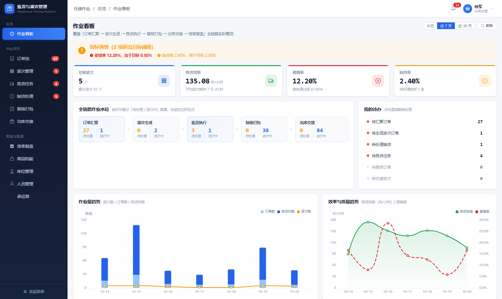
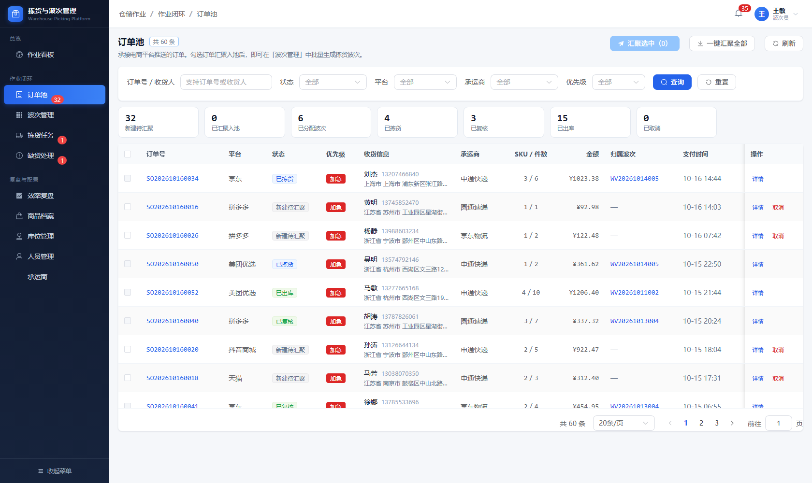
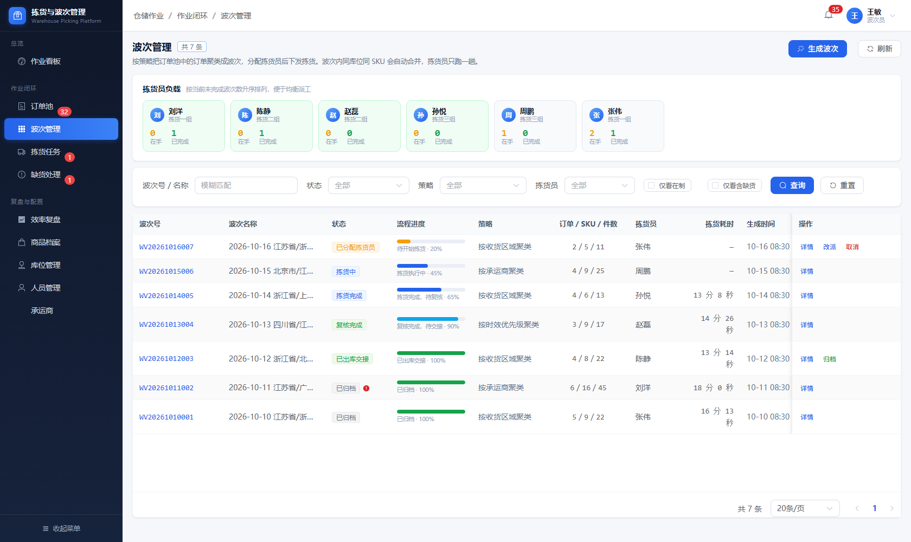
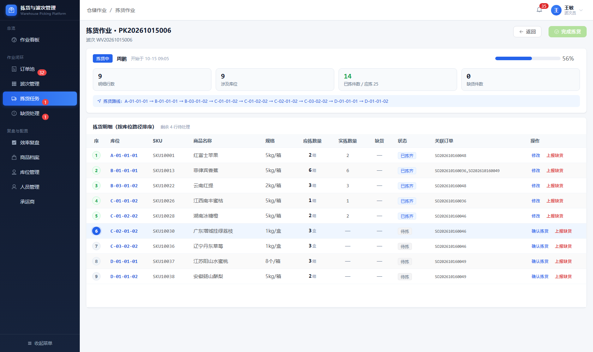
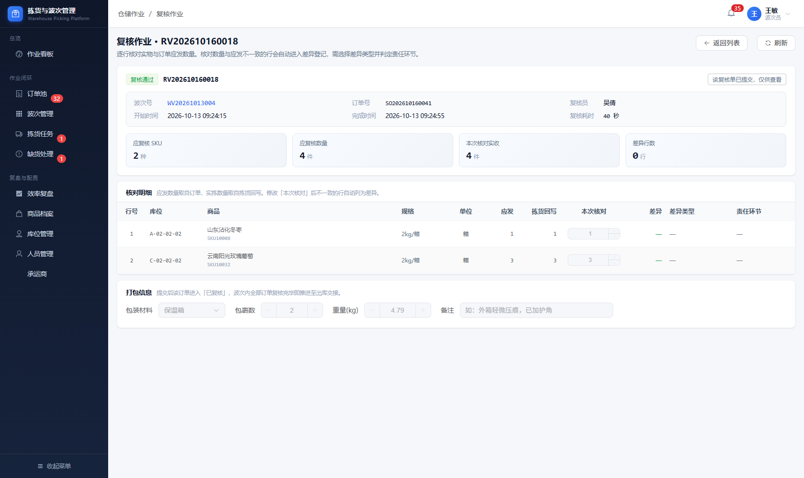
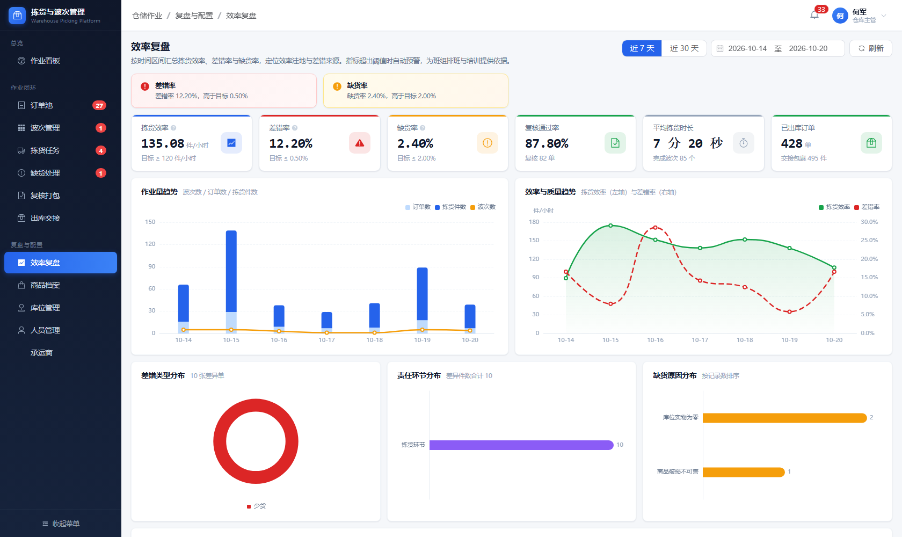

# WMS — Warehouse Picking & Wave Management System

A full-stack warehouse operation platform for e-commerce and distribution warehouses. It covers the
complete fulfilment chain — **order pooling → wave generation → picking execution → review & packing →
outbound handover → efficiency analytics** — for three operational roles: wave operator, picker and reviewer.


---

## Highlights

The parts that took real design work, rather than scaffolding a CRUD demo:

- **Contract-first API.** [`docs/api-contract.md`](docs/api-contract.md) is the single source of truth for
  all 54 endpoints: paths, parameters, response shapes, aggregate schemas and state machines. It carries a
  sync checklist and a `grep`-based verification step, so the document cannot silently drift from the code.
- **Server-enforced state machines.** Every transition (`WAITING → PICKING → EXCEPTION → FINISHED`) is
  validated on the server and cannot be skipped or rolled back. This closed three findings at once
  (`SEC-05` / `SEC-06` / `SEC-07`), where re-submission could overwrite a completed record.
- **Role whitelist authorization.** Write endpoints are guarded by `@RequireRole` and answer **403** on
  mismatch. The acting user is resolved **from the token**, never from a request parameter — passing
  someone else's operator number has no effect (`SEC-08`).
- **No-ORM by design.** `JdbcTemplate` plus a `JdbcMaps` helper converts `snake_case` columns to camelCase,
  so 16 tables need no entity classes and every query stays visible in the service layer.
- **Self-audited security posture.** 24 findings across white-box, black-box and concurrency rounds, each
  with reproduction commands and impact — including the attack classes verified as *not* exploitable.
- **Unit tests over the logic that fails silently.** Password hashing and the analytics alert thresholds are
  covered by JUnit 5 boundary tests; see [Quality assurance](#quality-assurance).

---

## Quality assurance

| Layer | What was done | Evidence |
| --- | --- | --- |
| **Security testing** | 24 findings across two rounds (white-box audit, black-box probing, concurrency): 1 critical · 7 high · 8 medium · 8 low. Every finding carries reproduction commands and impact, plus **8 attack classes verified as not exploitable** (SQL injection, token forgery, XSS, username enumeration, Actuator/Swagger exposure, TRACE, sensitive files). | [`docs/security-audit.md`](docs/security-audit.md) |
| **Fix verification** | 12 of 24 findings fixed and re-tested item by item, with verbatim retest output and a **regression pass** confirming the normal flows still work. The remaining 12 are tracked with a phased roadmap and named residual risks — nothing is silently dropped. | [`docs/security-fixes.md`](docs/security-fixes.md) |
| **Unit tests** | JUnit 5 suites over the pure logic: password hashing (salt randomness, plaintext and Base64 must both fail, null/blank handling, broken hashes must not throw) and every analytics alert threshold at its boundary value. | [`backend/src/test`](backend/src/test) |
| **API contract** | Endpoint count and response shapes are machine-verifiable against the controllers through a documented `grep` check. | [`docs/api-contract.md`](docs/api-contract.md) |

> The security documents were produced by auditing this codebase by hand — `curl`, the MySQL CLI, browser
> DevTools and `npm audit`. No scanners. The point was to map the system's real limits, including the
> places where it holds up.

---

## Table of contents

- [Highlights](#highlights)
- [Quality assurance](#quality-assurance)
- [What this system does](#what-this-system-does)
- [Screenshots](#screenshots)
- [Tech stack](#tech-stack)
- [Repository layout](#repository-layout)
- [Quick start](#quick-start)
- [Demo accounts](#demo-accounts)
- [Configuration](#configuration)
- [Database](#database)
- [API overview](#api-overview)
- [Authentication & authorization](#authentication--authorization)
- [Security](#security)
- [Documentation](#documentation)
- [Version history](#version-history)
- [FAQ](#faq)
- [License](#license)

---

## What this system does

```
Order pooling → Wave generation → Picking → Review & packing → Handover → Analytics
                      ↘ Shortage handling ↗      ↘ Error statistics ↗
```

| Capability | Description |
| --- | --- |
| Order pool | Filter orders by status, platform, carrier, province and priority; pool single or all pending orders |
| Wave strategy | Group orders by area, carrier, timeliness or order count; preview before committing |
| Picking | Tasks merged by `location + SKU`, sorted into a walkable pick path; confirm per line, report shortage |
| Shortage handling | Quantify the shortage, choose a handling type (substitute / cancel / replenish) and close it |
| Review & packing | Claim a wave, submit a review per order, record diff type and packing material |
| Outbound handover | Bundle reviewed waves per carrier, confirm or reject at the dock |
| Analytics | Pick efficiency, error rate, shortage distribution, per-employee performance |
| Traceability | Every write operation recorded in `operation_log` with a full per-document timeline |

---

## Screenshots

| Dashboard | Order pool |
| --- | --- |
|  |  |

| Wave management | Picking |
| --- | --- |
|  |  |

| Review & packing | Analytics |
| --- | --- |
|  |  |

More page-by-page screenshots (all captured against real data) live in [`shots-v4/`](shots-v4).

> The application ships with Chinese UI labels, enum descriptions and API messages — there is no i18n layer
> yet. Screenshots therefore show the Chinese interface, while this README and the docs are in English.

---

## Tech stack

| Layer | Technology |
| --- | --- |
| Backend | Spring Boot 4.1.1 · JDK 27 · Spring MVC · JdbcTemplate · HikariCP |
| Frontend | Vue 3.5 · Vite 8 · Element Plus 2.14 · Pinia · Vue Router · ECharts |
| Database | MySQL 8.0 (`wms_v4`), auto-created on first boot |
| Auth | Server-side session token (`Authorization: Bearer …`), BCrypt password hashing |
| Build | Maven 3.9+ (backend) · npm (frontend) |

The backend deliberately avoids an ORM: `JdbcMaps` converts `snake_case` columns to camelCase so the
16 tables need no entity classes, and `Repo` centralises query and audit-log helpers.

---

## Repository layout

```
.
├── backend/                    # Spring Boot service
│   ├── pom.xml
│   └── src/main/
│       ├── java/com/example/wms/
│       │   ├── config/         # TokenService, AuthInterceptor, WebConfig,
│       │   │                   # GlobalExceptionHandler, DatabaseInitializer
│       │   ├── common/         # Dict, JdbcMaps, PasswordHasher, AuthContext,
│       │   │                   # LoginUser, RequireRole, ForbiddenException
│       │   ├── service/        # Repo (queries + audit log), Stats (metric definitions)
│       │   ├── controller/     # 11 controllers, 54 endpoints
│       │   └── dto/            # ApiResult, PageResult, LoginRequest/Response
│       └── resources/
│           ├── application.properties
│           ├── schema.sql      # DDL, idempotent
│           └── seed.sql        # demo data snapshot (only loaded into an empty DB)
├── frontend/                   # Vue 3 SPA
│   ├── vite.config.js          # port 5173, /api → 127.0.0.1:8080
│   └── src/
│       ├── api/                # axios instance + endpoint wrappers
│       ├── stores/             # auth state, dictionary cache
│       ├── router/             # hash router + auth guard
│       ├── layouts/            # sidebar + top bar shell
│       ├── views/              # login, dashboard, order, wave, pick, shortage,
│       │                       # review, handover, analytics, base, error
│       └── components/         # ChartBox, PageHeader, StatCard, StatusTag
├── tools/
│   ├── gen-demo.sh             # one-command entry point
│   └── gen-demo-data.py        # demo data generator (self-checking, all-or-nothing)
├── shots-v4/                   # page-by-page screenshots
├── docs/
│   ├── api-contract.md         # API source of truth: conventions, fields, 54 endpoints, state machines
│   ├── security-audit.md       # white-box + black-box + web security report (24 findings)
│   └── security-fixes.md       # change log and rollback notes for the 12 fixed findings
└── README.md
```

---

## Quick start

### Prerequisites

| Tool | Version |
| --- | --- |
| JDK | 27 |
| Maven | 3.9+ |
| Node.js | 18+ |
| MySQL | 8.0, listening on `3306` |

### 1. Database

The application creates the schema and loads demo data automatically on first boot — you only need a
reachable MySQL instance and an account that may create a database.

```sql
-- optional: create the database yourself instead of relying on createDatabaseIfNotExist
CREATE DATABASE wms_v4 DEFAULT CHARACTER SET utf8mb4 COLLATE utf8mb4_general_ci;
```

### 2. Backend

```bash
cd backend

# Credentials are not committed — export them (or use a git-ignored
# application-local.properties, see Configuration below)
export WMS_DB_USER=root
export WMS_DB_PASS=<your-mysql-password>

mvn -B -DskipTests package
java -jar target/wms-v4-4.1.0.jar --server.port=8080
```

Startup is successful when the log ends with:

```
Tomcat started on port 8080 (http)
Started WmsApplication in 2.0 seconds
schema.sql executed (idempotent DDL)
empty database detected — seed.sql executed (demo data loaded)
```

> Always pass `--server.port=8080` explicitly. If your shell exports `SERVER__PORT`, that environment
> variable outranks `application.properties` and Spring will bind to a random port instead.

### 3. Frontend

```bash
cd frontend
npm install
npm run dev        # http://127.0.0.1:5173
```

The Vite dev server proxies every `/api/**` call to `127.0.0.1:8080`, so no backend URL is hard-coded in
the frontend. Production build:

```bash
npm run build      # output in dist/
```

---

## Demo accounts

All four accounts are seeded with the password **`123456`** and are stored as BCrypt hashes.

| Username | Role | Scope |
| --- | --- | --- |
| `admin` | ADMIN | Everything, incl. employee PII and audit log |
| `wave` | WAVE_OPERATOR | Order pooling, wave generation and assignment |
| `picker` | PICKER | Picking execution, shortage reporting |
| `reviewer` | REVIEWER | Review, packing and handover |

Menus are filtered per role by `meta.roles` plus the router guard. **Change these credentials (or drop the
seed data) before exposing the system to any network.**

---

## Configuration

`backend/src/main/resources/application.properties` reads every deployment-specific value from environment
variables, with local-development defaults:

| Property | Environment variable | Default |
| --- | --- | --- |
| `spring.datasource.url` | `WMS_DB_URL` | `jdbc:mysql://127.0.0.1:3306/wms_v4…` |
| `spring.datasource.username` | `WMS_DB_USER` | `root` |
| `spring.datasource.password` | `WMS_DB_PASS` | *(empty — set it locally)* |
| `server.port` | `SERVER_PORT` | `8080` |

Provide them via your shell, an IDE run configuration, or a git-ignored `.env`/`application-local.properties`.
Never commit real credentials; see [SEC-13](docs/security-audit.md) for the rationale.

---

## Database

16 tables, grouped by business area:

| Area | Tables |
| --- | --- |
| Master data | `sku`, `location`, `carrier`, `employee`, `sys_user` |
| Orders | `order`, `order_item` |
| Waves | `wave`, `wave_order` |
| Picking | `pick_task`, `pick_item` |
| Exceptions | `shortage`, `review`, `review_diff` |
| Handover | `handover` |
| Traceability | `operation_log` |

> `order` is a MySQL reserved word — always quote it as `` `order` `` in DDL and queries.

### Initialisation

`DatabaseInitializer` runs two scripts at startup:

1. **`schema.sql`** — `CREATE TABLE IF NOT EXISTS` only; runs on every boot and is idempotent.
2. **`seed.sql`** — demo data with `INSERT IGNORE` and explicit primary keys; runs **once**, only when the
   `carrier` table is empty.

`seed.sql` is a database snapshot (~1 MB), not a hand-maintained script. To refresh it:

```bash
mysqldump -u"$WMS_DB_USER" -p --default-character-set=utf8mb4 \
  --no-create-info --insert-ignore --complete-insert --compact \
  --no-tablespaces --single-transaction --set-gtid-purged=OFF wms_v4 \
  > backend/src/main/resources/seed.sql
```

`--insert-ignore` keeps re-runs safe; `--set-gtid-purged=OFF` keeps the dump re-importable on servers with
GTID enabled.

### Keeping the demo data current

A static snapshot goes stale: after a few days the "today / last 7 days" views are empty. Do not edit
timestamps by hand — that desynchronises derived fields such as `pick_duration_sec`. Extend the data
instead:

```bash
./tools/gen-demo.sh                    # append records up to the current minute
./tools/gen-demo.sh --dry-run          # print the SQL without touching the DB
./tools/gen-demo.sh --days 3           # backfill the last 3 days
./tools/gen-demo.sh --start "2026-11-01 09:00" --end "2026-11-03 18:00"
```

The generator only appends. Before committing a batch it creates a temporary stored procedure that
validates 11 invariants inside the same transaction — any violation raises `SQLSTATE '45000'` and the whole
batch is rolled back:

| # | Invariant | Prevents |
|---|-----------|----------|
| 1–3 | No future timestamps on waves, orders, picking, review, handover, shortage, logs | Records dated in the future |
| 4 | Document-number date equals its business timestamp (`SO/WV/PK/RV/HO/SH`) | Numbers that disagree with timestamps |
| 5 | Order time ≤ its wave creation time | Waves created before their orders |
| 6 | Node order: pick finish ≥ pick start, review ≥ pick finish, handover ≥ review | Out-of-order milestones |
| 7–8 | `wave.order_count` and `pick_task.should_qty` match their detail rows | Summary fields drifting from details |
| 9 | Order status is consistent with wave status | Handed-over waves with orders still `WAVED` |
| 10–11 | No duplicate keys, no orphan rows | Details pointing at missing documents |

After a successful run, re-export `seed.sql` so a rebuilt database starts from the fresh dates.

---

## API overview

11 modules, 54 endpoints. Every response uses the envelope
`{ "code": 0, "message": "ok", "data": {}, "timestamp": 1792389015103 }`, where `code === 0` means success.

| Module | Prefix | Endpoints |
| --- | --- | --- |
| Auth | `/api/auth` | 1 |
| Dashboard | `/api/dashboard` | 2 |
| Orders | `/api/order` | 6 |
| Waves | `/api/wave` | 8 |
| Picking | `/api/pick` | 7 |
| Shortage | `/api/shortage` | 5 |
| Review | `/api/review` | 5 |
| Handover | `/api/handover` | 4 |
| Analytics | `/api/analytics` | 5 |
| Master data | `/api/base` | 9 |
| Traceability | `/api/log` | 2 |

Method, parameters, business rules, aggregate shapes, enum dictionaries and state machines are documented
in **[`docs/api-contract.md`](docs/api-contract.md)** — treat it as the contract of record and update it
whenever a controller changes.

HTTP status codes are split in two layers, deliberately:

| Scenario | Status | Body |
| --- | --- | --- |
| Success | 200 | `code=0` |
| Business failure (validation, state-machine conflict) | **200** | `code=1` + user-facing message |
| Not logged in / expired token | 401 | `code=401` |
| Forbidden | 403 | `code=403` |
| Unknown route / wrong method | 404 / 405 | fixed message |
| Malformed request | 400 | fixed message |
| Unexpected server error | 500 | fixed message (stack trace only in logs) |

---

## Authentication & authorization

- `POST /api/auth/login` returns `{ token, employeeNo, employeeName, role, team }`.
- Every subsequent request carries `Authorization: Bearer <token>`. Tokens live in a server-side session
  table for 8 hours; the server never trusts the token payload, so forged or tampered tokens are rejected.
- Passwords are hashed with BCrypt (cost 10, per-hash salt). Legacy plaintext/Base64 hashes are migrated
  once at startup.
- Write endpoints declare a role whitelist via `@RequireRole`; a mismatch returns **403**. Unannotated
  endpoints are readable by any authenticated user.
- The acting user is always resolved from the token (`AuthContext`) — request parameters such as
  `pickerNo` or `reviewerNo` are ignored.

| Endpoint family | Write access |
| --- | --- |
| `/api/order/**` pool / cancel | ADMIN, WAVE_OPERATOR |
| `/api/wave/**` generate / assign / close | ADMIN, WAVE_OPERATOR |
| `/api/pick/**` execute | ADMIN, PICKER, WAVE_OPERATOR |
| `/api/review/**` review | ADMIN, REVIEWER |
| `/api/handover/**` handover | ADMIN, REVIEWER |
| `/api/shortage/**` handle | ADMIN, WAVE_OPERATOR |
| `/api/base/employee/page` | ADMIN only (contains PII) |
| `/api/log/page` | ADMIN only |

Document state machines are enforced server-side and cannot go backwards or skip steps:

```
order      CREATED → POOLED → WAVED → PICKED → REVIEWED → OUTBOUND   (CANCELLED allowed while CREATED/POOLED)
wave       CREATED → ASSIGNED → PICKING → PICKED → REVIEWING → REVIEWED → HANDOVERED → CLOSED
pick_task  WAITING → PICKING → FINISHED (EXCEPTION when a shortage is reported)
review     WAITING → PASS | DIFF
handover   CREATED → CONFIRMED | REJECTED
shortage   PENDING → HANDLED → CLOSED
```

---

## Security

The project ships with a full audit trail of its own security posture:

- **[`docs/security-audit.md`](docs/security-audit.md)** — 24 findings across two rounds (1 critical,
  7 high, 8 medium, 8 low), each with reproduction steps, impact and remediation, plus the list of attack
  classes verified as *not* exploitable (SQL injection, token forgery, XSS, username enumeration).
- **[`docs/security-fixes.md`](docs/security-fixes.md)** — the 12 findings fixed so far, with code-level
  detail, retest evidence and rollback instructions.

Fixed: `SEC-01` role authorization · `SEC-02` BCrypt hashing · `SEC-05` review re-submission ·
`SEC-06` handover re-confirmation · `SEC-07` state rollback · `SEC-08` operator spoofing ·
`SEC-09` exception leakage · `SEC-14` shortage over-reporting · `SEC-15` task ownership ·
`SEC-18` 404 semantics · `SEC-20` audit attribution · `SEC-22` parameter type errors.

Still open and tracked: login rate limiting (`SEC-03`), CORS whitelist (`SEC-04`), security headers
(`SEC-10`), token revocation (`SEC-11`), cookie-based sessions (`SEC-12`), externalised config (`SEC-13`,
partially addressed), field-level PII masking (`SEC-16`), pagination/body limits (`SEC-17`), demo
credentials in the UI (`SEC-19`), TLS (`SEC-21`), CRLF filtering (`SEC-23`), `pageSize` bounds (`SEC-24`).

This is a demonstration system. **Do not deploy it to production without closing the remaining findings.**

---

## Documentation

| Document | Contents |
| --- | --- |
| [docs/api-contract.md](docs/api-contract.md) | Global conventions, entity fields, enum dictionaries, all 54 endpoints, aggregate shapes, state machines |
| [docs/security-audit.md](docs/security-audit.md) | Security test report: methodology, 24 findings, retest evidence, remediation roadmap |
| [docs/security-fixes.md](docs/security-fixes.md) | Fix record: changed files, design of each fix, build notes, rollback steps |

---

## Version history

| Version | Highlights |
| --- | --- |
| A (v1) | First complete iteration: 11 tables, login and 14 pages, TypeScript frontend |
| B (v2) | Cleaner layering (domain/repository/service), Swagger, in-memory repository — no real database |
| v3 | Attempt to merge A's modules into B's skeleton; workable but two code styles side by side |
| v4.0.0 | B's UI on a rewritten backend: real MySQL, real login, mock layer removed, 56 endpoints |
| **v4.1.0** | **Current.** Security hardening and engineering cleanup: role authorization, BCrypt, state machines, operator context, 12 findings fixed, endpoints trimmed to 54, HTTP status codes corrected, `schema.sql` + `seed.sql` split, repository made deliverable |

---

## FAQ

**Backend fails with `Port 8080 was already in use`**
Find the owner with `netstat -ano | findstr :8080` and stop it (`taskkill /PID <pid> /F` on Windows).
Usually a previous JVM that did not exit, or a second copy of the app running on the same port.

**Backend binds to a random 6xxxx port**
Your environment exports `SERVER__PORT`. Pass `--server.port=8080` explicitly.

**Blank frontend page or 404 on `/api/**`**
Check the browser console: a blank page usually means the backend is down and the proxy returns 502. A 404
means the Vite proxy target and the backend `context-path` disagree — the target should be
`http://127.0.0.1:8080` and the context path `/`.

**Frontend starts on 5174 instead of 5173**
Vite increments the port when 5173 is taken. Not an error.

**`'vite' is not recognised as an internal or external command`**
`node_modules/.bin` is missing (common when a project is copied between operating systems). Delete
`node_modules` and run `npm install` again.

**Maven cannot find `WmsApplication` in IntelliJ**
The Maven module is not imported. Right-click `backend/pom.xml` → *Add as Maven Project*, then reload all
Maven projects and select the `wms-v4` module in the run configuration.

---

## License

Released under the MIT License. The demo dataset is synthetic; any resemblance to real persons,
addresses or phone numbers is coincidental.
