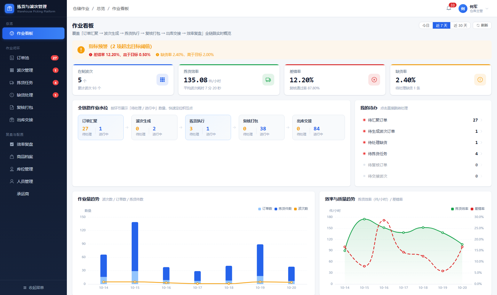
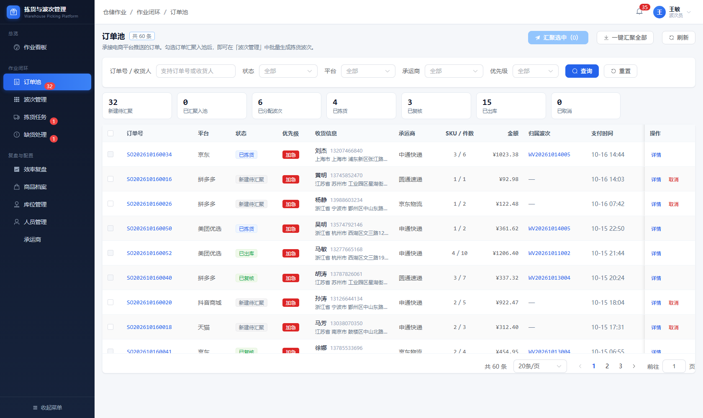
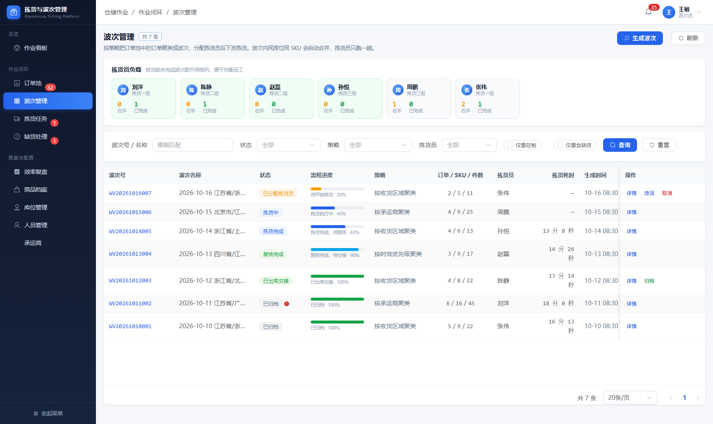
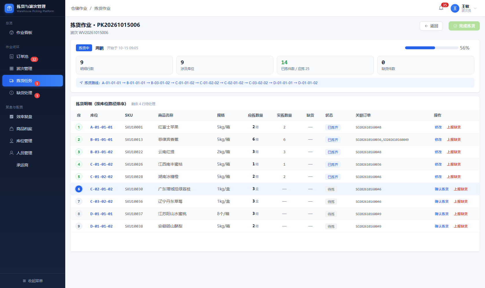
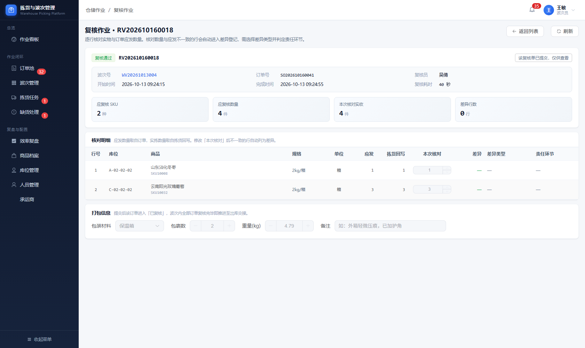
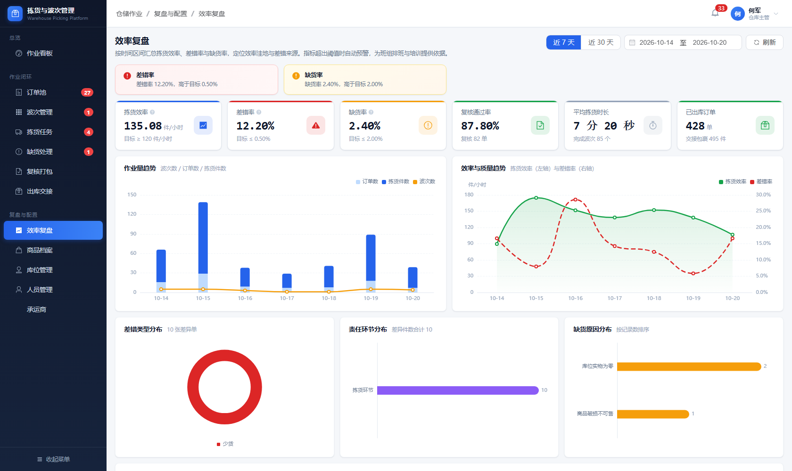

# WMS — 仓库拣货与波次管理系统

面向电商仓和配送仓的全栈仓储作业平台。覆盖完整履约链路：**订单汇聚 → 波次生成 → 拣货执行 → 复核打包 → 出库交接 → 效率分析**，对应三个作业角色：波次员、拣货员、复核员。

当前版本：**v5.0**。


[](https://github.com/ShiraiYuzen/WMS/actions/workflows/ci.yml)

---

## 亮点

这些是真正花过设计功夫的部分，不是搭一个增删改查演示：

- **契约优先的接口。** [`docs/api-contract.md`](docs/api-contract.md) 是全部 54 个接口的唯一依据：路径、参数、响应形状、聚合结构和状态机。文内有同步清单和基于 `grep` 的核对步骤，文档不会悄悄和代码脱节。
- **服务端强制的状态机。** 每次状态迁移（`WAITING → PICKING → EXCEPTION → FINISHED`）都在服务端校验，不能跳步，也不能回退。这同时关掉了三条发现（`SEC-05` / `SEC-06` / `SEC-07`）：重复提交会覆盖已经完成的记录。
- **角色白名单授权。** 写接口用 `@RequireRole` 保护，角色不符返回 **403**。操作人**从令牌解析**，不从请求参数取——传入别人的工号没有效果（`SEC-08`）。
- **MyBatis-Plus 数据访问。** 16 个实体加对应的 `BaseMapper`；单表增删改查用 `LambdaQueryWrapper` 和分页插件。多表和动态 SQL 走 `SqlSupport`（PreparedStatement + 驼峰 Map），复杂的仓储连接保持显式，不使用不安全的 `${sql}`。
- **自己做完的安全评估。** 白盒、黑盒和并发三轮共 24 条发现，每条都有复现命令和影响说明，也包括验证为**不能利用**的攻击类型。
- **覆盖会静默出错的逻辑。** 口令散列和看板告警阈值有 JUnit 5 边界测试，见[质量保证](#质量保证)。

---

## 质量保证

| 层次 | 做了什么 | 证据 |
| --- | --- | --- |
| **安全测试** | 两轮共 24 条发现（白盒审计、黑盒探测、并发）：1 严重 · 7 高 · 8 中 · 8 低。每条都有复现命令和影响，另有 **8 类攻击验证为不能利用**（SQL 注入、伪造令牌、XSS、用户名枚举、Actuator/Swagger 暴露、TRACE、敏感文件）。 | [`docs/security-audit.md`](docs/security-audit.md) |
| **修复验证** | 24 条里的 12 条已修复并逐条复测，附复测原文和一次**回归**，确认正常流程仍然可用。剩下 12 条按阶段路线跟踪，并写明残留风险，没有悄悄丢掉。 | [`docs/security-fixes.md`](docs/security-fixes.md) |
| **单元测试** | 针对纯逻辑的 JUnit 5：口令散列（盐随机、明文和 Base64 都必须失败、空值处理、损坏散列不能抛异常）以及每条看板告警阈值的边界。 | [`backend/src/test`](backend/src/test) |
| **接口契约** | 接口数量和响应形状可以用文档里的 `grep` 和控制器对上。 | [`docs/api-contract.md`](docs/api-contract.md) |

> 安全文档是手工审计这份代码得到的：`curl`、MySQL 命令行、浏览器开发者工具和 `npm audit`。没有用扫描器。目的是画出系统真实的边界，包括它守得住的地方。

---

## 目录

- [亮点](#亮点)
- [质量保证](#质量保证)
- [系统做什么](#系统做什么)
- [界面截图](#界面截图)
- [技术栈](#技术栈)
- [仓库结构](#仓库结构)
- [快速开始](#快速开始)
- [演示账号](#演示账号)
- [配置](#配置)
- [数据库](#数据库)
- [接口概览](#接口概览)
- [认证与授权](#认证与授权)
- [安全](#安全)
- [文档](#文档)
- [版本历史](#版本历史)
- [常见问题](#常见问题)
- [许可证](#许可证)

---

## 系统做什么

```
订单汇聚 → 波次生成 → 拣货 → 复核打包 → 交接 → 分析
                 ↘ 缺货处理 ↗      ↘ 差错统计 ↗
```

| 能力 | 说明 |
| --- | --- |
| 订单池 | 按状态、平台、承运商、省份、优先级筛选；单张或全部待处理订单汇入池中 |
| 波次策略 | 按区域、承运商、时效或单量分组；提交前可以预览 |
| 拣货 | 按 `库位 + SKU` 合并任务，排成可走的拣货路径；逐行确认，上报缺货 |
| 缺货处理 | 量化缺货，选择处理方式（替代 / 取消 / 补货）并关闭 |
| 复核打包 | 领取波次，按订单提交复核，记录差异类型和包材 |
| 出库交接 | 按承运商把已复核波次打包，在月台确认或驳回 |
| 分析 | 拣货效率、差错率、缺货分布、员工业绩 |
| 追溯 | 每次写操作写入 `operation_log`，单据有完整时间线 |

---

## 界面截图

| 看板 | 订单池 |
| --- | --- |
|  |  |

| 波次管理 | 拣货 |
| --- | --- |
|  |  |

| 复核打包 | 分析 |
| --- | --- |
|  |  |

按页面拍的其余截图（都对着真实数据）在 [`shots-v5/`](shots-v5)。

> 界面文案、枚举说明和接口消息都是中文，目前没有国际化层。截图因此显示中文界面。

---

## 技术栈

| 层 | 技术 |
| --- | --- |
| 后端 | Spring Boot 4.1.1 · JDK 27 · Spring MVC · **MyBatis-Plus 3.5.18** · HikariCP |
| 前端 | Vue 3.5 · Vite 8 · Element Plus 2.14 · Pinia · Vue Router · ECharts |
| 数据库 | MySQL 8.0（库名 `wms_v5`），首次启动自动创建 |
| 认证 | 服务端会话令牌（`Authorization: Bearer …`），口令使用 BCrypt |
| 构建 | Maven 3.9+（后端）· npm（前端） |

单表访问使用 MyBatis-Plus 实体和 Mapper；复杂动态 SQL 使用 `SqlSupport`。业务在领域服务里，控制器只做薄的 HTTP 适配。

---

## 仓库结构

```
.
├── backend/                    # Spring Boot 服务
│   ├── pom.xml                 # MyBatis-Plus spring-boot4-starter 3.5.18，版本 5.0
│   └── src/main/
│       ├── java/com/example/wms/
│       │   ├── config/         # MybatisPlusConfig、TokenService、AuthInterceptor、
│       │   │                   # WebConfig、GlobalExceptionHandler、DatabaseInitializer
│       │   ├── common/         # Dict、Maps、SqlSupport、PasswordHasher、AuthContext、
│       │   │                   # LoginUser、RequireRole、ForbiddenException
│       │   ├── entity/         # 16 个 MyBatis-Plus 实体（WmsOrder → `order`）
│       │   ├── mapper/         # 每张表一个 BaseMapper
│       │   ├── service/        # 领域服务 + Stats
│       │   │   └── support/    # BizNumbers、VoAssembler、OperationLogService
│       │   ├── controller/     # 11 个薄控制器，54 个接口
│       │   └── dto/            # ApiResult、PageResult、LoginRequest/Response
│       └── resources/
│           ├── application.properties
│           ├── schema.sql      # 建表，可重复执行
│           └── seed.sql        # 演示数据快照（只在空库时加载）
├── frontend/                   # Vue 3 单页应用
│   ├── vite.config.js          # 端口 5173，/api → 127.0.0.1:8080
│   └── src/
│       ├── api/                # axios 实例和接口封装
│       ├── stores/             # 登录状态、字典缓存
│       ├── router/             # hash 路由 + 登录守卫
│       ├── layouts/            # 侧栏 + 顶栏
│       ├── views/              # 登录、看板、订单、波次、拣货、缺货、
│       │                       # 复核、交接、分析、主数据、差错
│       └── components/         # ChartBox、PageHeader、StatCard、StatusTag
├── tools/
│   ├── gen-demo.sh             # 命令行入口
│   ├── gen-demo-data.py        # 演示数据生成器（自检，失败整批回滚）
│   ├── 一键生成演示数据.sh       # macOS：按任意键开始 / 结束后再按任意键
│   └── 一键生成演示数据.bat      # Windows：同上，UTF-8 BOM
├── shots-v5/                   # 按页面的截图
├── docs/
│   ├── api-contract.md         # 接口依据：约定、字段、54 个接口、状态机
│   ├── security-audit.md       # 白盒 + 黑盒 + Web 安全报告（24 条发现）
│   └── security-fixes.md       # 已修复 12 条的变更说明和回滚步骤
└── README.md
```

---

## 快速开始

### 环境

| 工具 | 版本 |
| --- | --- |
| JDK | 27 |
| Maven | 3.9+ |
| Node.js | 18+ |
| MySQL | 8.0，监听 `3306` |

### 1. 数据库

应用在首次启动时自动建表并加载演示数据。只需要一台能连上的 MySQL，以及有建库权限的账号。

```sql
-- 可选：自己建库，而不依赖 createDatabaseIfNotExist
CREATE DATABASE wms_v5 DEFAULT CHARACTER SET utf8mb4 COLLATE utf8mb4_general_ci;
```

库名是 `wms_v5`，与产品版本 5.0 对应。

### 2. 后端

```bash
cd backend

# 口令不入库。用环境变量，或使用被 git 忽略的
# application-local.properties，见下方「配置」
export WMS_DB_USER=root
export WMS_DB_PASS=<你的 MySQL 口令>

mvn -B -DskipTests package
java -jar target/wms-v5-5.0.jar --server.port=8080
```

日志末尾出现下面几行，表示启动成功：

```
Tomcat started on port 8080 (http)
Started WmsApplication in 2.0 seconds
schema.sql executed (idempotent DDL)
empty database detected — seed.sql executed (demo data loaded)
```

> 请显式传入 `--server.port=8080`。如果 shell 里有 `SERVER__PORT`，它的优先级高于 `application.properties`，Spring 会绑到一个随机端口。

### 3. 前端

```bash
cd frontend
npm install
npm run dev        # http://127.0.0.1:5173
```

Vite 开发服务器把所有 `/api/**` 代理到 `127.0.0.1:8080`，前端没有写死后端地址。生产构建：

```bash
npm run build      # 输出在 dist/
```

---

## 演示账号

四个账号的口令都是 **`123456`**，库里存的是 BCrypt 散列。

| 用户名 | 角色 | 范围 |
| --- | --- | --- |
| `admin` | ADMIN | 全部，含员工个人信息和审计日志 |
| `wave` | WAVE_OPERATOR | 订单汇聚、波次生成和指派 |
| `picker` | PICKER | 拣货执行、缺货上报 |
| `reviewer` | REVIEWER | 复核、打包和交接 |

菜单按 `meta.roles` 和路由守卫过滤。**把系统暴露到任何网络之前，请改掉这些口令，或去掉种子数据。**

---

## 配置

`backend/src/main/resources/application.properties` 里和部署有关的值都从环境变量读取，并带本地开发默认值：

| 配置项 | 环境变量 | 默认值 |
| --- | --- | --- |
| `spring.datasource.url` | `WMS_DB_URL` | `jdbc:mysql://127.0.0.1:3306/wms_v5…` |
| `spring.datasource.username` | `WMS_DB_USER` | `root` |
| `spring.datasource.password` | `WMS_DB_PASS` | *（空，请在本地设置）* |
| `server.port` | `SERVER_PORT` | `8080` |

可以用 shell、IDE 运行配置，或被 git 忽略的 `.env` / `application-local.properties`。不要提交真实口令，原因见 [SEC-13](docs/security-audit.md)。

---

## 数据库

16 张表，按业务分组：

| 领域 | 表 |
| --- | --- |
| 主数据 | `sku`、`location`、`carrier`、`employee`、`sys_user` |
| 订单 | `order`、`order_item` |
| 波次 | `wave`、`wave_order` |
| 拣货 | `pick_task`、`pick_item` |
| 异常 | `shortage`、`review`、`review_diff` |
| 交接 | `handover` |
| 追溯 | `operation_log` |

> `order` 是 MySQL 保留字，DDL 和查询里要写成 `` `order` ``。

### 初始化

`DatabaseInitializer` 在启动时跑两段脚本：

1. **`schema.sql`**：只有 `CREATE TABLE IF NOT EXISTS`；每次启动都跑，可重复执行。
2. **`seed.sql`**：演示数据，`INSERT IGNORE` 且带明确主键；**只跑一次**，仅当 `carrier` 表为空。

`seed.sql` 是数据库快照（约 1 MB），不是手写脚本。要刷新它：

```bash
mysqldump -u"$WMS_DB_USER" -p --default-character-set=utf8mb4 \
  --no-create-info --insert-ignore --complete-insert --compact \
  --no-tablespaces --single-transaction --set-gtid-purged=OFF wms_v5 \
  > backend/src/main/resources/seed.sql
```

`--insert-ignore` 让重复导入安全；`--set-gtid-purged=OFF` 让开启了 GTID 的服务器也能重新导入。

### 让演示数据保持最新

静态快照会过期：过几天「今天 / 近 7 天」就是空的。不要手改时间戳，那会让 `pick_duration_sec` 这类派生字段对不上。应该续写数据：

```bash
./tools/gen-demo.sh                    # 续写到当前分钟
./tools/gen-demo.sh --dry-run          # 只打印 SQL，不写库
./tools/gen-demo.sh --days 3           # 补最近 3 天
./tools/gen-demo.sh --start "2026-11-01 09:00" --end "2026-11-03 18:00"

# 双击或在终端运行，开始前、结束后都会停下来等按键
./tools/一键生成演示数据.sh             # macOS
tools\一键生成演示数据.bat              # Windows
```

生成器只追加。提交一批之前，它在同一事务里建一个临时存储过程，校验 11 条不变量。任何一条不通过就抛 `SQLSTATE '45000'`，整批回滚：

| # | 不变量 | 防止 |
| --- | --- | --- |
| 1–3 | 波次、订单、拣货、复核、交接、缺货、日志都没有未来时间 | 日期在未来的记录 |
| 4 | 单号里的日期等于业务时间（`SO/WV/PK/RV/HO/SH`） | 单号和业务时间不一致 |
| 5 | 下单时间 ≤ 所属波次的创建时间 | 波次比订单更早 |
| 6 | 节点顺序：拣完 ≥ 拣货开始，复核 ≥ 拣完，交接 ≥ 复核 | 里程碑倒序 |
| 7–8 | `wave.order_count` 和 `pick_task.should_qty` 与明细一致 | 汇总和明细漂移 |
| 9 | 订单状态与波次状态一致 | 已交接的波次里订单仍是 `WAVED` |
| 10–11 | 没有重复键，没有孤儿行 | 明细指向不存在的单据 |

成功之后重新导出 `seed.sql`，重建的库才会从新日期开始。

---

## 接口概览

11 个模块，54 个接口。响应都是信封
`{ "code": 0, "message": "ok", "data": {}, "timestamp": 1792389015103 }`，`code === 0` 表示成功。

| 模块 | 前缀 | 接口数 |
| --- | --- | --- |
| 认证 | `/api/auth` | 1 |
| 看板 | `/api/dashboard` | 2 |
| 订单 | `/api/order` | 6 |
| 波次 | `/api/wave` | 8 |
| 拣货 | `/api/pick` | 7 |
| 缺货 | `/api/shortage` | 5 |
| 复核 | `/api/review` | 5 |
| 交接 | `/api/handover` | 4 |
| 分析 | `/api/analytics` | 5 |
| 主数据 | `/api/base` | 9 |
| 追溯 | `/api/log` | 2 |

方法、参数、业务规则、聚合形状、枚举和状态机写在 **[`docs/api-contract.md`](docs/api-contract.md)**。把它当作正式契约，控制器一改就要同步。

HTTP 状态码故意分成两层：

| 场景 | 状态码 | 响应体 |
| --- | --- | --- |
| 成功 | 200 | `code=0` |
| 业务失败（校验、状态机冲突） | **200** | `code=1` + 给用户看的消息 |
| 未登录 / 令牌过期 | 401 | `code=401` |
| 无权限 | 403 | `code=403` |
| 未知路径 / 方法不对 | 404 / 405 | 固定消息 |
| 请求格式错误 | 400 | 固定消息 |
| 未预期的服务器错误 | 500 | 固定消息（堆栈只进日志） |

---

## 认证与授权

- `POST /api/auth/login` 返回 `{ token, employeeNo, employeeName, role, team }`。
- 之后每个请求带 `Authorization: Bearer <token>`。令牌在服务端会话表里保留 8 小时；服务端不信任令牌载荷，伪造或篡改的令牌会被拒绝。
- 口令用 BCrypt（cost 10，每次独立盐）。启动时把历史明文 / Base64 一次性迁移。
- 写接口用 `@RequireRole` 声明角色白名单，不符返回 **403**。没有注解的接口，任何已登录用户都可以读。
- 操作人始终从令牌解析（`AuthContext`）。请求里的 `pickerNo`、`reviewerNo` 会被忽略。

| 接口族 | 写权限 |
| --- | --- |
| `/api/order/**` 汇聚 / 取消 | ADMIN、WAVE_OPERATOR |
| `/api/wave/**` 生成 / 指派 / 关闭 | ADMIN、WAVE_OPERATOR |
| `/api/pick/**` 执行 | ADMIN、PICKER、WAVE_OPERATOR |
| `/api/review/**` 复核 | ADMIN、REVIEWER |
| `/api/handover/**` 交接 | ADMIN、REVIEWER |
| `/api/shortage/**` 处理 | ADMIN、WAVE_OPERATOR |
| `/api/base/employee/page` | 仅 ADMIN（含个人信息） |
| `/api/log/page` | 仅 ADMIN |

单据状态机在服务端执行，不能倒退，也不能跳步：

```
order      CREATED → POOLED → WAVED → PICKED → REVIEWED → OUTBOUND   （CREATED/POOLED 时可 CANCELLED）
wave       CREATED → ASSIGNED → PICKING → PICKED → REVIEWING → REVIEWED → HANDOVERED → CLOSED
pick_task  WAITING → PICKING → FINISHED（上报缺货时为 EXCEPTION）
review     WAITING → PASS | DIFF
handover   CREATED → CONFIRMED | REJECTED
shortage   PENDING → HANDLED → CLOSED
```

---

## 安全

仓库自带一份完整的安全评估记录：

- **[`docs/security-audit.md`](docs/security-audit.md)**：两轮 24 条发现（1 严重、7 高、8 中、8 低），每条有复现步骤、影响和修复建议，以及验证为不能利用的攻击类型（SQL 注入、伪造令牌、XSS、用户名枚举）。
- **[`docs/security-fixes.md`](docs/security-fixes.md)**：已经修复的 12 条，含代码级说明、复测证据和回滚步骤。

已修复：`SEC-01` 角色授权 · `SEC-02` BCrypt · `SEC-05` 复核重复提交 · `SEC-06` 交接重复确认 · `SEC-07` 状态回退 · `SEC-08` 冒充操作人 · `SEC-09` 异常泄露 · `SEC-14` 缺货超量 · `SEC-15` 任务归属 · `SEC-18` 404 语义 · `SEC-20` 审计操作人 · `SEC-22` 参数类型错误。

仍开放并跟踪：登录限流（`SEC-03`）、CORS 白名单（`SEC-04`）、安全响应头（`SEC-10`）、令牌吊销（`SEC-11`）、Cookie 会话（`SEC-12`）、外置配置（`SEC-13`，已部分处理）、字段级个人信息脱敏（`SEC-16`）、分页和请求体上限（`SEC-17`）、界面上的演示账号（`SEC-19`）、TLS（`SEC-21`）、CRLF 过滤（`SEC-23`）、`pageSize` 下限（`SEC-24`）。

这是演示系统。**剩下的发现没有关掉之前，不要部署到生产环境。**

---

## 文档

| 文档 | 内容 |
| --- | --- |
| [docs/api-contract.md](docs/api-contract.md) | 全局约定、实体字段、枚举、全部 54 个接口、聚合形状、状态机 |
| [docs/security-audit.md](docs/security-audit.md) | 安全测试报告：方法、24 条发现、复测证据、修复路线 |
| [docs/security-fixes.md](docs/security-fixes.md) | 修复记录：改了哪些文件、每条修复的设计、构建说明、回滚步骤 |

---

## 版本历史

| 版本 | 要点 |
| --- | --- |
| A（v1） | 第一版完整迭代：11 张表、登录和 14 个页面、TypeScript 前端 |
| B（v2） | 分层更干净（domain/repository/service）、Swagger、内存仓储，没有真实数据库 |
| v3 | 试图把 A 的模块并进 B 的骨架；能用，但两套代码风格并存 |
| v4.0.0 | 用 B 的界面配重写的后端：真实 MySQL、真实登录、去掉 mock，56 个接口 |
| v4.1.0 | 安全加固和工程整理：角色授权、BCrypt、状态机、操作人上下文，修复 12 条发现，接口收到 54 个，HTTP 状态码纠正，`schema.sql` 与 `seed.sql` 拆开；数据访问迁到 **MyBatis-Plus**，按 `entity` / `mapper` / `service` / `controller` 分层 |
| **v5.0** | **当前版本。** 版本号升至 5.0，文档改为中文，并补充 Windows / macOS 一键生成演示数据脚本 |

---

## 常见问题

**后端报 `Port 8080 was already in use`**
用 `netstat -ano | findstr :8080` 找占用进程并停掉（Windows 上 `taskkill /PID <pid> /F`）。通常是上次 JVM 没退出，或同一端口上又起了一份。

**后端绑到随机的 6xxxx 端口**
环境里有 `SERVER__PORT`。显式传入 `--server.port=8080`。

**前端空白，或 `/api/**` 返回 404**
看浏览器控制台：空白页通常是后端没起来，代理返回 502。404 表示 Vite 代理目标和后端 `context-path` 不一致——目标应是 `http://127.0.0.1:8080`，上下文路径是 `/`。

**前端开在 5174 而不是 5173**
5173 被占用时 Vite 会顺延端口。这不是错误。

**`'vite' 不是内部或外部命令`**
缺少 `node_modules/.bin`（项目在操作系统之间拷贝时常见）。删掉 `node_modules` 再执行 `npm install`。

**IntelliJ 里 Maven 找不到 `WmsApplication`**
Maven 模块没导入。右键 `backend/pom.xml` → *Add as Maven Project*，重新加载全部 Maven 项目，并在运行配置里选中 `wms-v5` 模块。

---

## 许可证

以 MIT 许可证发布。演示数据是合成的；若与真人、地址或电话号码相似，纯属巧合。
